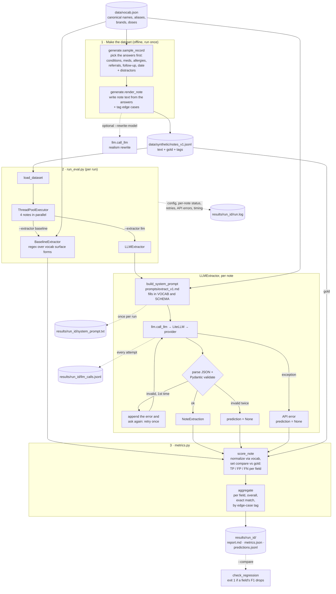
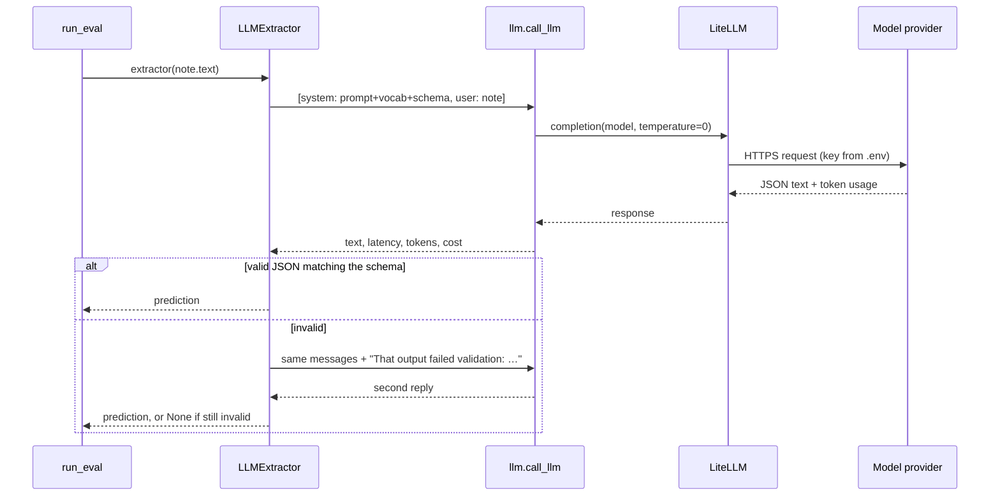

# Architecture

## What gets extracted

Each note is turned into one `NoteExtraction` object (`schema.py`):

| Field | Type | Example from note text → extracted value |
|---|---|---|
| `visit_date` | date | "Seen 09/26/2026" → `2026-09-26` |
| `visit_type` | one of 3 | "Telehealth encounter" → `telehealth` |
| `patient_age` | int | "66 y/o F" → `66` |
| `conditions` | list | "Diagnoses: ASD and seizure disorder. Denies history of OSA." → `["autism spectrum disorder", "epilepsy"]` (OSA is denied, so it's left out) |
| `medications` | list | "Takes Keppra 250 mg BID. Previously on Prilosec, stopped." → `["levetiracetam"]` |
| `allergies` | list | "Allergic to shellfish and sulfa drugs." → `["shellfish", "sulfa drugs"]` |
| `referrals` | list | "Will refer to neuro." → `["neurology"]` |
| `follow_up_weeks` | int | "Return in four weeks." → `4` |

List values are always the **canonical names** from `data/vocab.json` (16 conditions, 14 medications, 5 allergies, 8 referrals), each with aliases and brand names.

## Two extractors, not a pipeline

It's **not** regex followed by an LLM. There are two interchangeable extractors, and `--extractor` picks one per run. Both produce the same `NoteExtraction` and are scored the same way, so they're directly comparable.

- **Baseline** (`--extractor baseline`): regex only. It matches every alias or brand name from the vocab and pulls out dates, age and follow-up with patterns. It's free and offline, but it can't read context, so "Denies asthma" still yields `asthma`. It's the floor an LLM has to beat.
- **LLM** (`--extractor llm`): one model call per note, no regex. The model gets a system prompt (rules, plus the canonical names, plus the JSON schema) and the note text, and replies with JSON.

## Components and data flow



## What each run writes (`results/<run_id>/`)

| File | What's in it | Use it to |
|---|---|---|
| `report.md` | Precision, recall and F1 per field and per edge case; failures by type; latency; wall clock and parallelism; cost per 1k notes | Read the headline result |
| `metrics.json` | The same numbers in machine-readable form, plus run config and stats | Compare runs; regression gate |
| `predictions.jsonl` | Per note: prediction, gold, the FP/FN for each field, raw reply, `error_type`, `attempts` | Error analysis |
| `llm_calls.jsonl` | **One line per LLM attempt**, retries and failures included: start and end timestamps, latency, tokens, cost, status (`ok`, `invalid_output`, `rate_limit`, `auth`, `timeout`, …), raw reply, retry feedback, worker thread | Debug a note; find slow calls; see queueing and rate limits |
| `run.log` | Human-readable: config and git commit, one line per note, warnings for retries and API errors, summary | Follow a run while it's in progress (`tail -f`) |
| `system_prompt.txt` | The exact prompt the model saw (its sha256 is in every trace line) | Reproduce a run |

API errors are classified by type (`llm.classify_error`), and error messages are redacted so keys never reach the logs. Notes that failed on an API error are left out of cost per 1k and counted separately.

Datasets: `generate` refuses to overwrite an existing file (use `--out data/synthetic/notes_v2.jsonl`, or `--force` deliberately) and writes a `notes_vN.meta.json` sidecar recording the seed, n, vocab hash, git commit and file hash.

## One LLM call, step by step



## Scoring in one picture

For every field, the prediction and the gold label are each turned into a **set** of normalized values ("Zoloft 50 mg" → `sertraline`). Then:

```
gold = {asthma, ASD}        pred = {asthma, OSA}
TP = pred ∩ gold = {asthma}   → 1
FP = pred − gold = {OSA}      → 1   (invented or not excluded)
FN = gold − pred = {ASD}      → 1   (missed)
```

Single-value fields are sets of size 0 or 1, so a wrong age counts as 1 FP and 1 FN, and a missing age counts as 1 FN. Counts are summed across all notes before computing precision, recall and F1.
